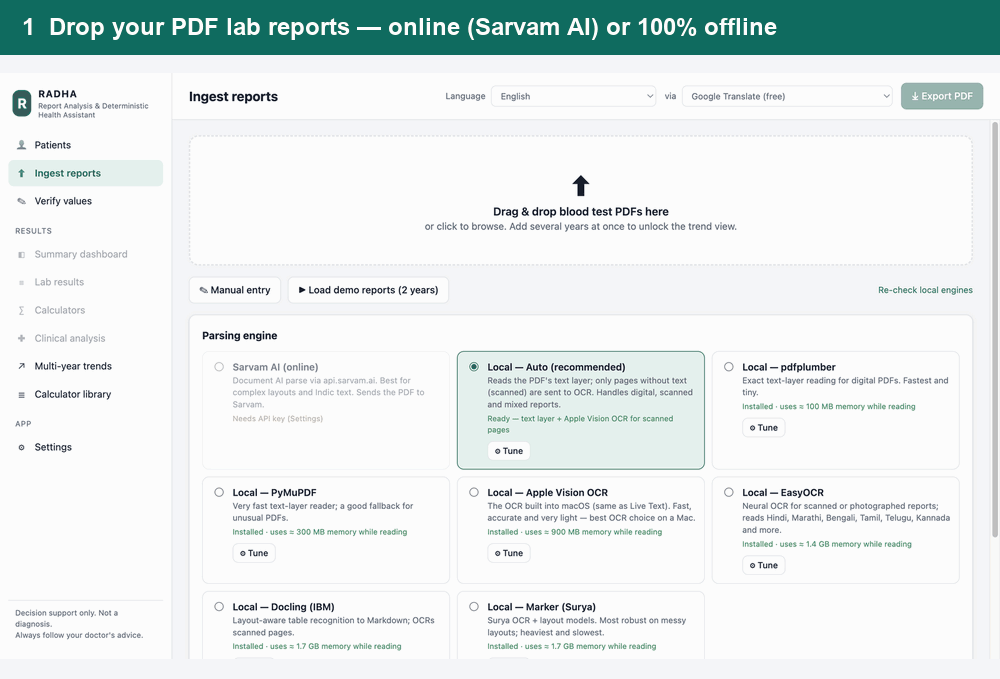
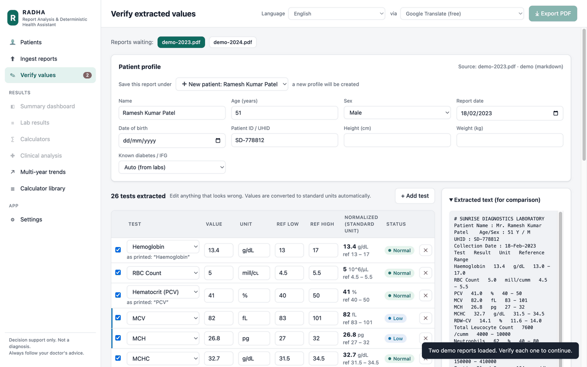
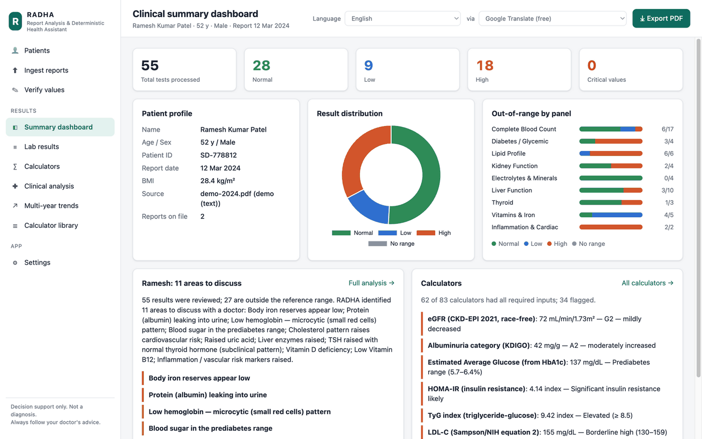
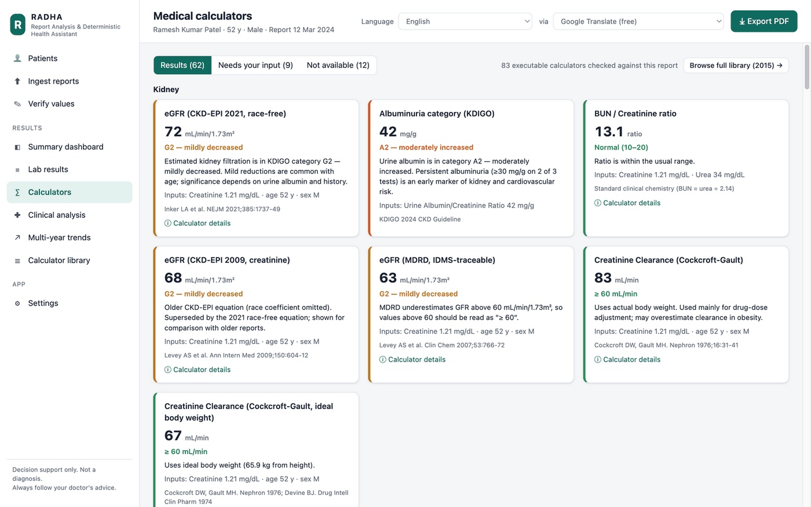
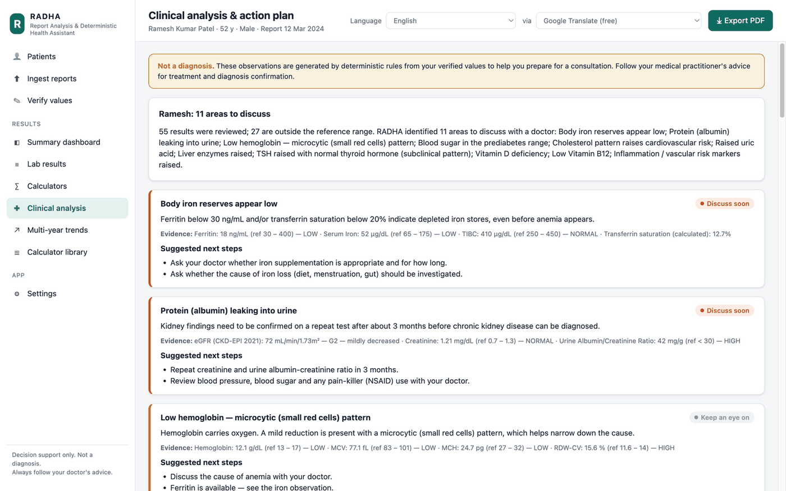
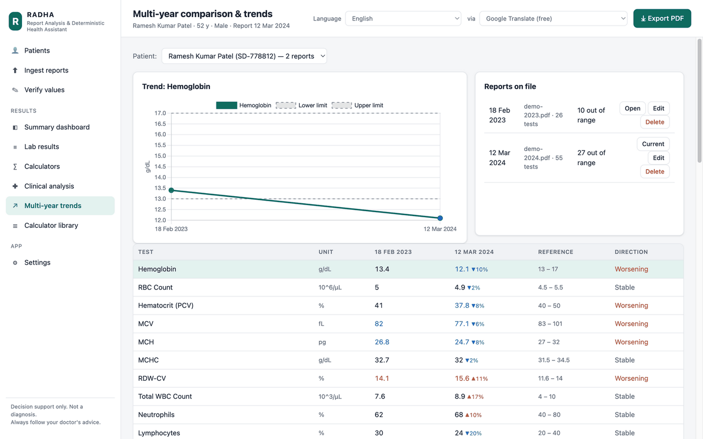
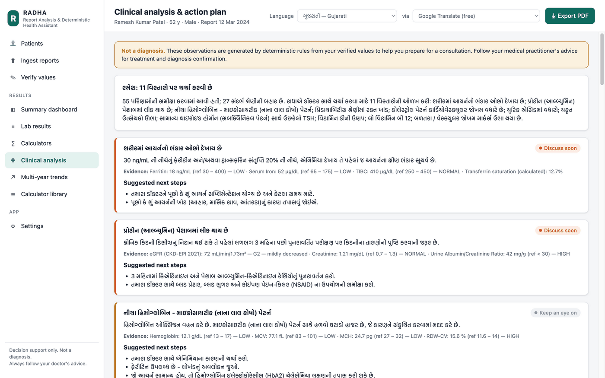

# RADHA — Report Analysis & Deterministic Health Assistant

An Electron desktop app that turns blood-test PDFs into a verified, structured clinical summary, runs 83 medical calculators locally, tracks results across years, manages patient profiles, and exports a patient-friendly PDF in 23 languages.



📖 **[Illustrated user guide](docs/USER-GUIDE.md)**: how to use RADHA, every feature with screenshots, and [how a report is generated](docs/USER-GUIDE.md#4-how-a-report-is-generated).

⬇️ **[Download for macOS (Apple silicon) or Windows (x64)](../../releases/latest)** · 📄 Sample output: [English PDF](docs/sample/RADHA-sample-summary-english.pdf) · [Gujarati PDF](docs/sample/RADHA-sample-summary-gujarati.pdf)

| Verify every value | Summary dashboard | 83 calculators |
|---|---|---|
|  |  |  |
| **Findings & doctor questions** | **Multi-year trends** | **Your language** |
|  |  |  |

> RADHA is decision support for patients preparing for a consultation. It does not diagnose. Every export carries a caution note: follow your medical practitioner's advice for treatment and diagnosis confirmation.

## Quick start

```bash
npm install
npm start
```

Click **Load demo reports (2 years)** on the Ingest screen to try every view without a real PDF.

### Local parsing engines (optional, one click)

Open **Ingest reports** and click **Install essentials** (pdfplumber, PyMuPDF, Apple Vision OCR — ≈ 0.2 GB) or **Install all local engines** (adds EasyOCR, Docling, Marker — ≈ 2.2 GB in total). RADHA downloads [uv](https://github.com/astral-sh/uv) if needed, creates a private Python 3.12 in `~/Library/Application Support/RADHA/engines`, installs the packages and downloads the models. Each engine card shows its download size and memory use, and **Tune** opens per-engine settings with a **Test on a report…** button. See the [user guide](docs/USER-GUIDE.md#311-local-engines--one-click-install-and-tuning).

Manual alternative: `pip install -r python/requirements.txt` into your own Python 3.10+, then set **Settings → Advanced: use my own Python**.

### Sarvam AI (optional)

Add your API subscription key in **Settings**. It is stored encrypted through the OS keychain (Electron `safeStorage`). You can also set the `SARVAM_API_KEY` environment variable.

## Workflow

| Step | What happens | Code |
|---|---|---|
| 1. Ingest | Drag and drop PDFs (or choose files, or enter values manually). Engines: **Sarvam AI Document AI** (online) or local **Auto / pdfplumber / PyMuPDF / Apple Vision OCR / EasyOCR / Docling / Marker**, each installable and tunable from the app. | `src/main/sarvam.js`, `python/parse_report.py` |
| 2. Extract | Text or Markdown is mapped to about 75 canonical biomarkers using an alias dictionary. Each gets its value, unit, reference range and flag. Patient name, age, sex, date and ID are read from the header. Unknown tests that have a range are kept as "Other". | `src/shared/extractor.js` |
| 3. Normalize | Units are converted to one standard per marker (mmol/L→mg/dL, µmol/L→mg/dL, nmol/L→ng/mL, lakhs/cumm→10³/µL, and so on). The report's own reference range is converted the same way. If the report has no range, a sex-specific default is used. | `src/shared/biomarkers.js` |
| 4. Verify (human in the loop) | An editable table shows each value as printed next to its normalized value, with the extracted text alongside. Nothing is analysed until you press **Confirm**. | `viewVerify` in `src/renderer/app.js` |
| 5. Calculators | The router runs every calculator whose inputs are all present and lists what is missing for the rest. | `src/shared/calculators.js` |
| 6. Analysis | Deterministic rules produce observations with evidence and next steps, plus a full list of questions for the doctor. The questions cover every finding, every out-of-range or borderline result, flagged calculators, changes since the previous report, and common tests missing from the report. An optional AI narrative is generated from de-identified data. | `src/shared/analysis.js`, `src/shared/questions.js` |
| 7. Trends | Verified reports are saved locally and grouped by patient ID (or name). The trend view shows a year-by-year table, % change, direction, and a chart with reference limits. | `viewTrends` |
| 8. Export | The top-right button saves an A4 PDF with the caution note, profile, chart, analysis, calculators, labs and trends. It uses the selected language. | `src/renderer/export.js` |
| 9. Translate | Pick the language, and the service next to it (**via**): free Google Translate (no key), Sarvam AI, official Google Cloud Translation (key), free MyMemory (no key, daily limit), LibreTranslate (self-hosted), or the AI provider chosen for the narrative (for example, free Pollinations or local Ollama). | `src/main/translators.js`, `src/renderer/translate.js` |

## Open / close with one click

- **Open RADHA.command**: opens the installed app. If it isn't installed, it opens the build in `dist/`, or runs from source.
- **Close RADHA.command**: quits RADHA, whichever of those is running.

Double-click either file in Finder. The first time, macOS may ask you to confirm opening a file downloaded or created outside the App Store. Right-click the file and choose **Open**.

## Install / download

Download from the [latest release](../../releases/latest):

- **macOS (Apple silicon):** `RADHA-<version>-arm64.dmg`. Open it and drag **RADHA** into Applications. The app is not code-signed, so open it the first time with right-click → **Open**.
- **Windows 10/11 (x64):** `RADHA-Setup-<version>-x64.exe`. Run it and choose where to install. The installer is not code-signed, so Windows SmartScreen may warn: click **More info → Run anyway**. Apple Vision OCR is macOS-only; on Windows use Auto, EasyOCR, Docling or Marker for scanned reports.

To rebuild: `npm run dist` (macOS DMG). The Windows installer is built by the **Windows installer** GitHub Actions workflow on a Windows runner and attached to each published release (or run it manually from the Actions tab with a release tag).

## Calculator library

`src/data/calculator-library.json` holds 2,015 unique calculators, merged from the scraped calculator data. It keeps descriptions, inputs, formulas and equations, interpretation, evidence, notes, articles, FAQs, references, MeSH/LOINC/ICD codes and specialties. Source websites, URLs, site names and site credits are removed. To regenerate it:

```bash
python3 scripts/build_calculator_library.py "/path/to/ALL CALCULATOR DATA"
```

The **Calculator library** screen searches every entry, and every entry can be filled in and calculated. The **Calculate** box at the top of each calculator works in one of three ways:

| Label | Count | How the result is produced |
|---|---|---|
| ✓ Verified RADHA calculator | 122 entries | RADHA's own tested implementation. Values come from the open report, can be edited, and the result updates as you type. |
| Σ Auto-scored | 123 | Each answer shows its points; the total and risk category update as you click. Points come from the calculator's published points table (`scripts/calculator_scoring.py`). A calculator is auto-scored only when every answer matched its points unambiguously. |
| ✎ AI-assisted | the rest | Editable inputs with units, then **Calculate with** the AI provider chosen in the box: Pollinations (default, free, no key), Ollama (local), Sarvam AI, ChatGPT, Gemini, Claude or any OpenAI-compatible endpoint. Only the formula text and the entered values are sent (no name or report), and the result is labelled as not verified. |

Age, sex, height, weight and lab values from the open report are filled in automatically (marked **REPORT**), including age brackets and Yes/No lab thresholds such as "Creatinine >2.0 mg/dL" after unit conversion. To re-derive the points tables without rebuilding the library: `python3 scripts/calculator_scoring.py src/data/calculator-library.json`.

## Built-in calculators

83 executable calculators, implemented from the primary publications and unit-tested against worked examples. A sample:

eGFR CKD-EPI 2021, 2009, cystatin C 2012 and creatinine + cystatin C 2021 · MDRD · Cockcroft-Gault (actual and ideal weight) · KFRE 4-variable · FENa · FEUrea · MELD, MELD-Na, MELD 3.0 · Child-Pugh · ALBI · Maddrey · Lille · Glasgow AH · ABIC · R factor · BARD · ASCVD pooled cohort equations · QUICKI · HOMA-β · METS-IR · thalassaemia indices (England-Fraser, Green-King, Shine-Lal, Srivastava, RDWI, Sirdah) · reticulocyte production index · Ganzoni · corrected sodium (Katz, Hillier) · free-water and sodium deficits · delta ratio · Winters · osmolal gap · mGPS · LRINEC · BSA, IBW, lean body weight, total body water

Calculators that need values not found on a lab report (INR, blood pressure, smoking, urine electrolytes…) appear under **Needs your input**. Values you enter there are saved with the report.

Earlier built-in set: eGFR CKD-EPI 2021 · KDIGO albuminuria · BUN/creatinine · eAG from HbA1c · HOMA-IR · TyG · LDL (Sampson/NIH and Friedewald) · non-HDL · Castelli I/II · Atherogenic Index of Plasma · TG/HDL · remnant cholesterol · De Ritis · FIB-4 · APRI · NAFLD Fibrosis Score · Hepatic Steatosis Index · NLR · PLR · Mentzer · corrected calcium · anion gap · serum osmolality · transferrin saturation · BMI (Asian cut-offs)

### Adding your own calculator

Add an object to `CALCULATORS` in `src/shared/calculators.js`:

```js
{
  id: 'my_score', name: 'My score', category: 'Kidney',
  requires: ['creatinine', 'age'],          // biomarker keys from biomarkers.js, or age/sex/height/weight/bmi
  reference: 'Author, Journal Year',
  compute: ({ creatinine }, { age }) => ({ value: 1.23, unit: 'pts', band: 'Low', severity: 'ok', interpretation: '…' }),
}
```

Inputs always arrive in the canonical units listed in `biomarkers.js`. The router picks up the new calculator automatically.

## Patients

The **Patients** tab keeps one profile per person:
- **Profile:** identity, contact, lab IDs, height, weight, blood pressure, smoking, alcohol, conditions, medicines, allergies, family history and notes.
- **Reports:** every report for that person, with Open, Edit, Move to another patient and Delete.
- **Data tools:** export all results as a CSV (Excel), merge duplicate profiles, and back up or restore everything (patients and reports) as a JSON file.

When a report is verified, it is matched to an existing profile by lab ID or name, or a new profile is created. Profile data fills gaps in reports (sex, DOB → age, height/weight) and pre-fills calculator inputs (blood pressure, BP medicine and smoking for ASCVD; known diabetes for the fatty-liver scores). Reports saved before profiles existed are linked automatically by name.

## AI narrative providers

Settings → **AI providers** chooses who writes the optional plain-language summary:

| Provider | Key | Notes |
|---|---|---|
| Pollinations | none (free) | Public free service; data processed on their servers; can be slow |
| Ollama | none (local) | Runs on this computer — install from ollama.com and `ollama pull` a model |
| Sarvam AI | Sarvam key | Same key as parsing / translation |
| ChatGPT (OpenAI) | platform.openai.com | |
| Google Gemini | aistudio.google.com | Free tier available |
| Claude (Anthropic) | platform.claude.com | Official Anthropic SDK; default `claude-opus-5-5` with server-side refusal fallback |
| Custom | optional | Any OpenAI-compatible endpoint (OpenRouter, Groq, LM Studio…) |

Keys are encrypted with the macOS keychain. **Load models** lists what each provider offers, and **Test** sends a one-line check.

## Privacy

- Local engines keep everything on the machine. Reports are stored in `radha-db.json` in the app's user-data folder.
- The Sarvam parse engine uploads the PDF. The AI narrative and translations send only results and findings, never the patient's name or ID.

## Tests

```bash
npm test                                   # extraction, unit conversion, calculators, analysis
RADHA_SMOKE=./smoke-out npx electron .     # drives the real UI with demo data, screenshots each view, exports a PDF
```

**Regenerate the guide's screenshots and GIF** (uses the synthetic demo patient):

```bash
RADHA_SMOKE=docs/_capture RADHA_SCRIPT=scripts/capture-docs.js npx electron .
python3 scripts/build_docs_media.py docs/_capture
```
