# RADHA — Illustrated User Guide

**R**eport **A**nalysis & **D**eterministic **H**ealth **A**ssistant turns blood-test PDFs into a verified, easy-to-read health summary on your own computer.

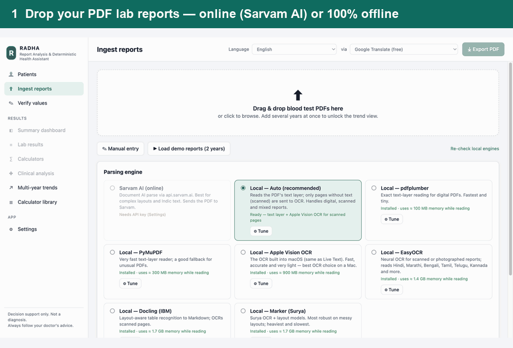

> All screenshots use RADHA's built-in **demo patient** (synthetic data). RADHA supports understanding and consultation preparation — it does **not** diagnose. Always follow your medical practitioner's advice.

**Contents**
1. [Install and open](#1-install-and-open)
2. [Quick start in 5 steps](#2-quick-start-in-5-steps)
3. [Feature tour](#3-feature-tour)
4. [How a report is generated](#4-how-a-report-is-generated)
5. [The exported PDF report](#5-the-exported-pdf-report)
6. [Settings: AI and translation services](#6-settings-ai-and-translation-services)
7. [Privacy and safety](#7-privacy-and-safety)
8. [Troubleshooting](#8-troubleshooting)

---

## 1. Install and open

1. Download the latest **`RADHA-…-arm64.dmg`** from the [Releases](../../../releases) page (Apple-silicon Macs).
2. Open the DMG and drag **RADHA** into **Applications**.
3. First launch only: right-click **RADHA** → **Open** → **Open** (the app is not code-signed).
4. Optional one-click helpers in the repository: **`Open RADHA.command`** and **`Close RADHA.command`**.

**Optional extras**
- **Offline PDF reading:** `pip install -r python/requirements.txt`, then set the Python path in **Settings**.
- **Online services:** add a Sarvam AI key (parsing and translation) and any AI provider keys in **Settings**. Free options need no key.

---

## 2. Quick start in 5 steps

| Step | What you do | Where |
|---|---|---|
| 1 | Drag and drop one or more PDF reports (or click **Load demo reports**) | **Ingest reports** |
| 2 | Check the extracted values, correct anything, choose the patient, then click **Confirm & analyse** | **Verify values** |
| 3 | Read the summary, lab results, calculators and findings | **Results** section |
| 4 | Choose a **Language** (and the translation service next to it) if you want | Top bar |
| 5 | Click **Export PDF** and take it to your doctor | Top right |

---

## 3. Feature tour

### 3.1 Ingest reports — online or 100% offline

Drop PDFs onto the box, or browse. Choose how they are read:

| Engine | Where it runs | Best for |
|---|---|---|
| **Sarvam AI** | Online (needs key) | Complex layouts, Indian lab formats |
| **Auto** | Offline | Picks the best installed engine; falls back to OCR for scanned PDFs |
| **pdfplumber / PyMuPDF** | Offline | Digital (text) PDFs — fast and exact |
| **Docling (IBM)** | Offline | Layout-aware tables |
| **Marker (Surya)** | Offline | Difficult layouts (slower) |
| **EasyOCR** | Offline | Scanned or photographed reports |

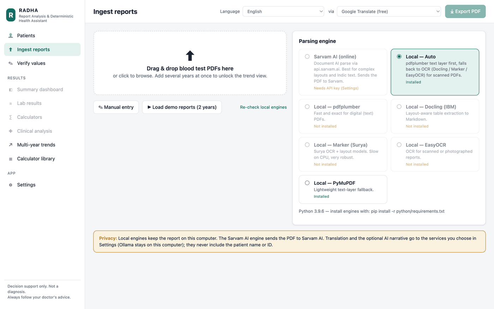

### 3.2 Verify values (human in the loop)

Nothing is analysed until you approve it.
- **Each row:** the test, the value **as printed**, the unit, the reference range, and the **normalised** value in one standard unit. For example, mmol/L becomes mg/dL and lakhs/cumm becomes 10³/µL.
- **Checking against the PDF:** the original report text is shown on the right for comparison.
- **Patient:** the report is matched to an existing patient by lab ID or name, or a new profile is created. Date of birth, height and weight are read when they are printed.
- **Editing:** fix any value, unit or range, add tests, or untick a row to leave it out.

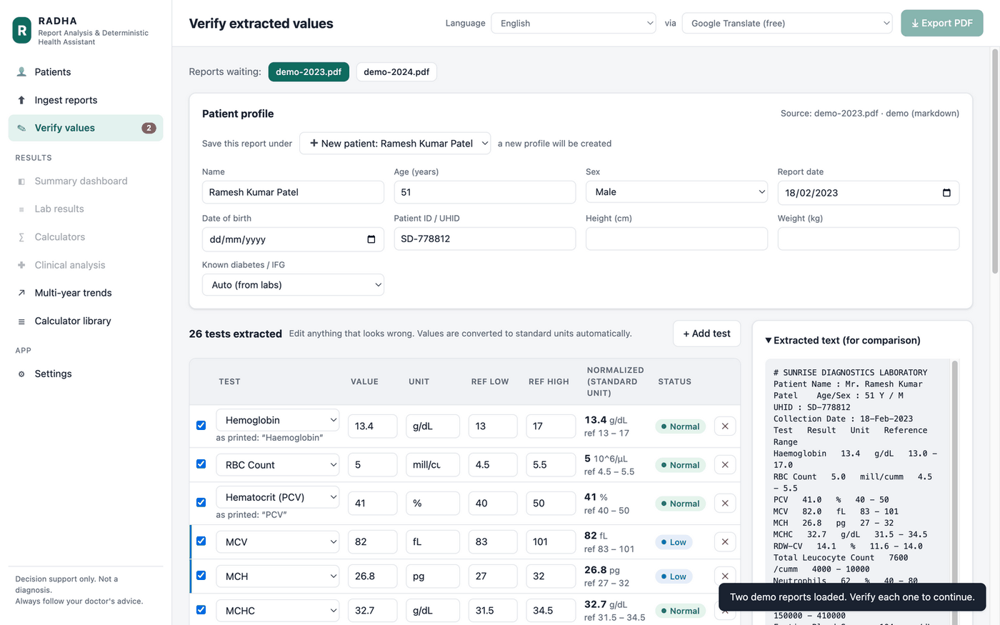

### 3.3 Summary dashboard

The dashboard shows:
- the patient profile;
- the total number of tests, with counts of **Normal / Low / High / Critical** results;
- a distribution chart and out-of-range counts by panel;
- the top findings and flagged calculators.

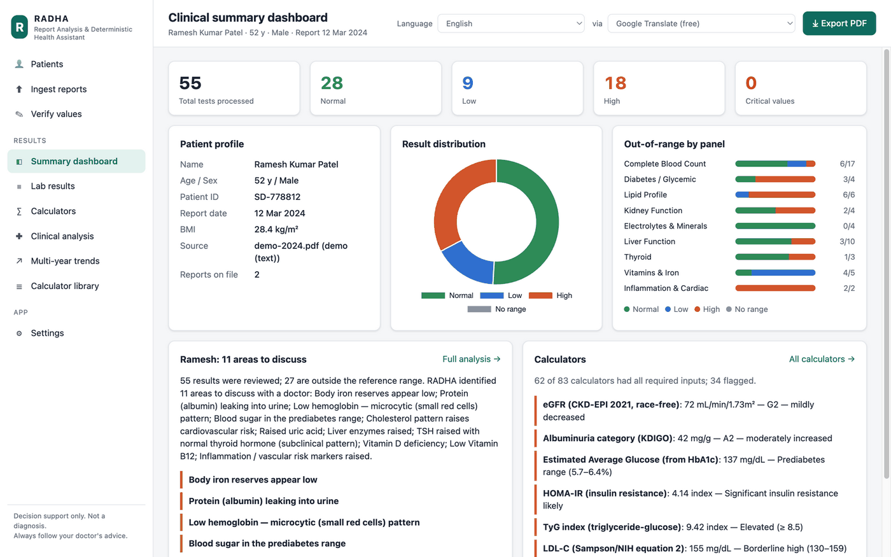

### 3.4 Lab results

Every biomarker is listed, grouped by panel, with the result, unit, reference range, a **position bar** and a colour-coded status. The **Out of range** filter shows only abnormal results.

| All results | Out of range only |
|---|---|
| 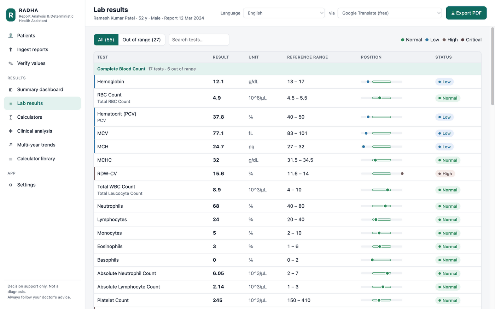 | 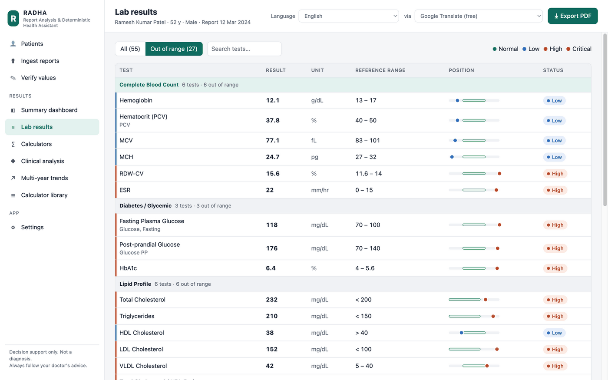 |

### 3.5 Medical calculators

- **83 executable calculators**, written from the original publications and unit-tested against worked examples. Among them: eGFR (CKD-EPI 2021, 2009, cystatin C), MDRD, Cockcroft-Gault, KFRE, FIB-4, APRI, NAFLD fibrosis score, MELD / MELD-Na / MELD 3.0, Child-Pugh, ALBI, HOMA-IR, QUICKI, TyG, Sampson and Friedewald LDL, ASCVD, NLR, thalassaemia indices, corrected calcium and sodium, anion gap, BMI and BSA.
- **Results:** calculators whose inputs are all in the report run automatically.
- **Needs your input:** values a lab report doesn't contain, such as blood pressure or INR, can be typed in once.
- **Not available:** lists exactly what is missing for each remaining calculator.

| Results | Needs your input |
|---|---|
| 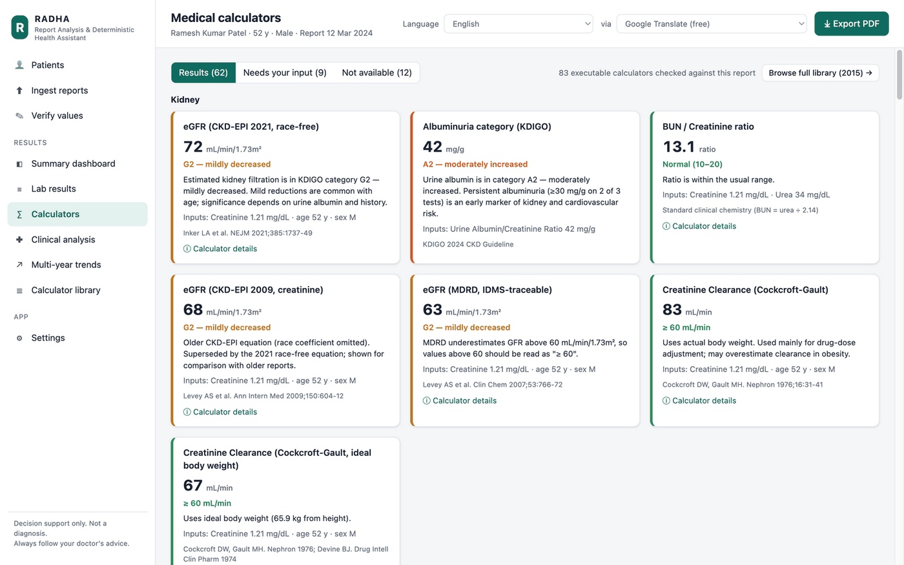 | 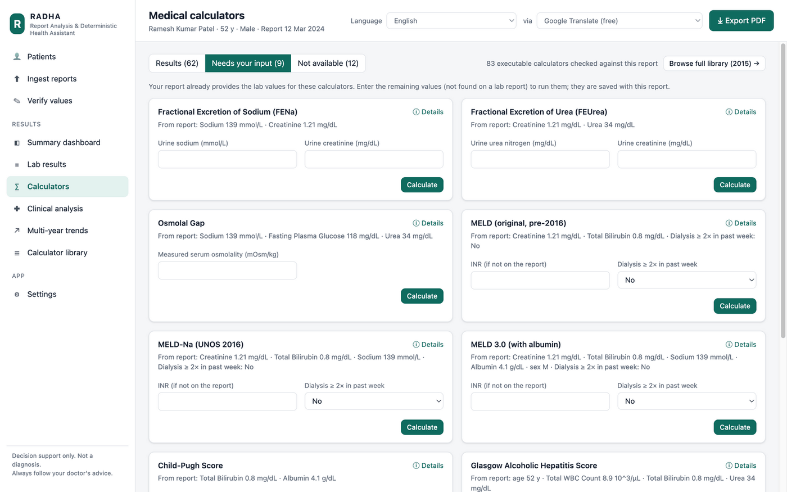 |

**Calculator details and library.** **ⓘ Calculator details** opens the full write-up for a calculator: description, inputs, formula, interpretation, evidence and references. The **Calculator library** lets you search all 2,015 calculators.

| Calculator details | Library |
|---|---|
| 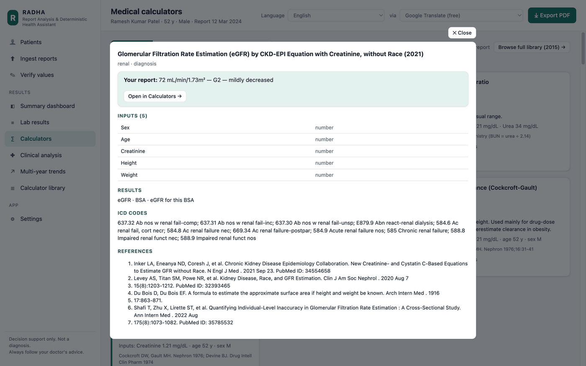 | 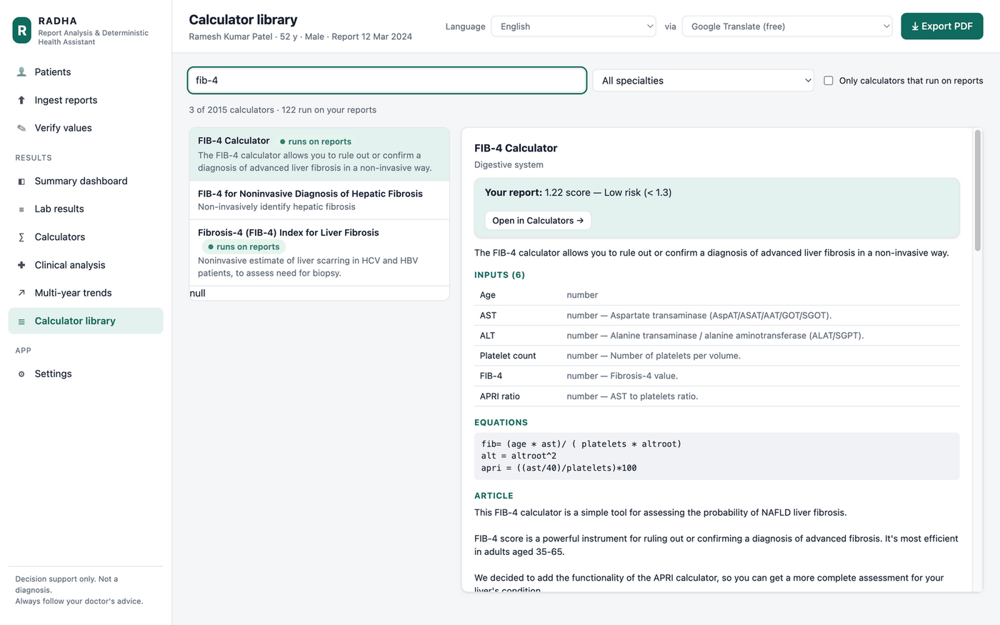 |

### 3.6 Clinical analysis and questions for your doctor

Deterministic rules turn the verified values into findings. Each finding comes with **evidence** from your report, a severity label (*Discuss promptly / Discuss soon / Keep an eye on*) and suggested next steps.

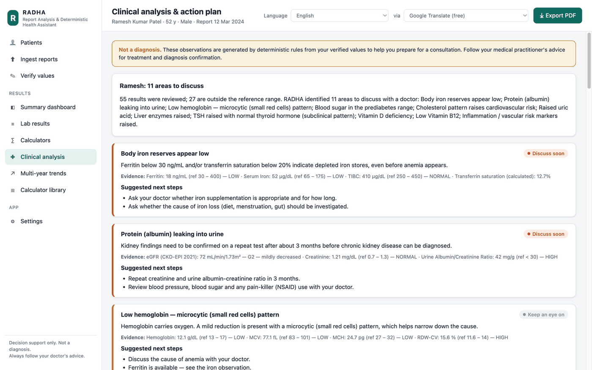

**Questions to ask your doctor** is a numbered list, grouped by topic. It covers:
- every finding;
- every other out-of-range result;
- borderline values close to a limit;
- flagged calculators;
- changes since your last report;
- common tests the report did not include.

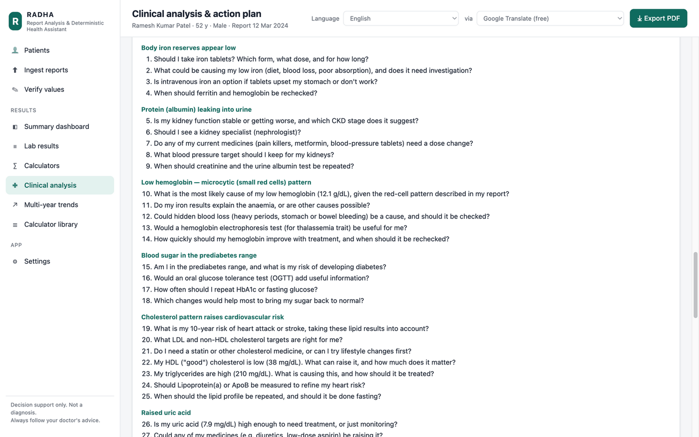

### 3.7 AI narrative summary (optional)

The AI narrative is an optional plain-language summary. You choose who writes it:

| Provider | Key |
|---|---|
| **Pollinations** | Free, no key needed |
| **Ollama** | Runs locally on your computer, no key needed |
| **Sarvam AI** | Your Sarvam key |
| **ChatGPT (OpenAI)** | Your OpenAI key |
| **Google Gemini** | Your Gemini key |
| **Claude (Anthropic)** | Your Anthropic key |
| **Custom** | Any OpenAI-compatible service |

Only de-identified results are sent (never the name or ID). The rule-based findings above remain the source of truth.

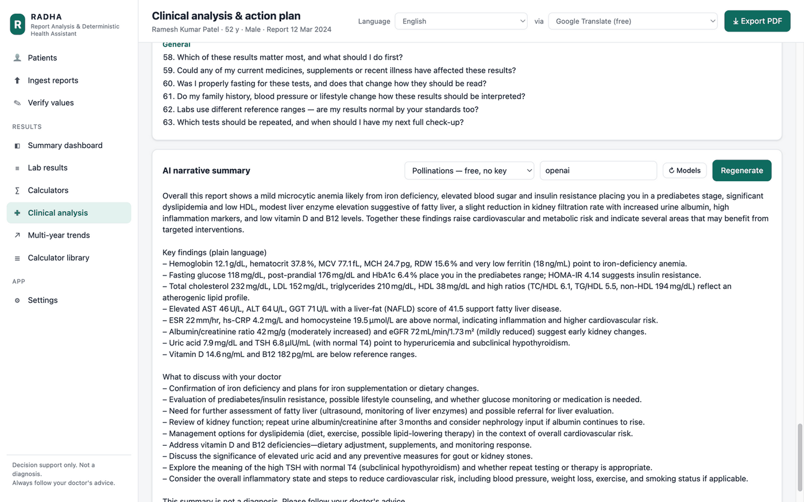

### 3.8 Multi-year trends

With reports from more than one date, the Trends screen shows:
- a side-by-side table of every test, with the % change from the previous report and an **Improving / Worsening / Stable** label;
- a chart for the selected test against its reference limits.

Reports from the same day are merged into one visit.

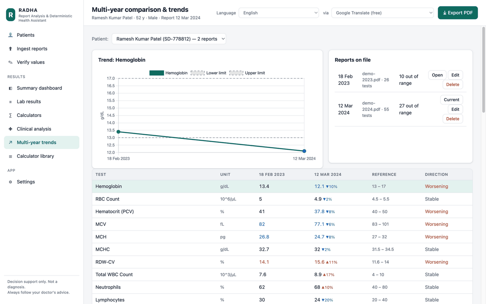

### 3.9 Your language

Choose from 13 Indian languages (Hindi, Gujarati, Bangla, Telugu, Tamil, Marathi, Kannada, Malayalam, Punjabi, Odia, Urdu, Assamese, Nepali) and 10 world languages. Pick the translation service next to the language:

| Service | Cost / key |
|---|---|
| **Google Translate** | Free, no key |
| **MyMemory** | Free, no key (daily limit) |
| **Sarvam AI** | Your Sarvam key |
| **Google Cloud Translation** | Your Google Cloud key |
| **LibreTranslate** | Free if self-hosted |
| **Your AI provider** | Uses the AI chosen for the narrative |

Test names, numbers and units stay exactly as printed.

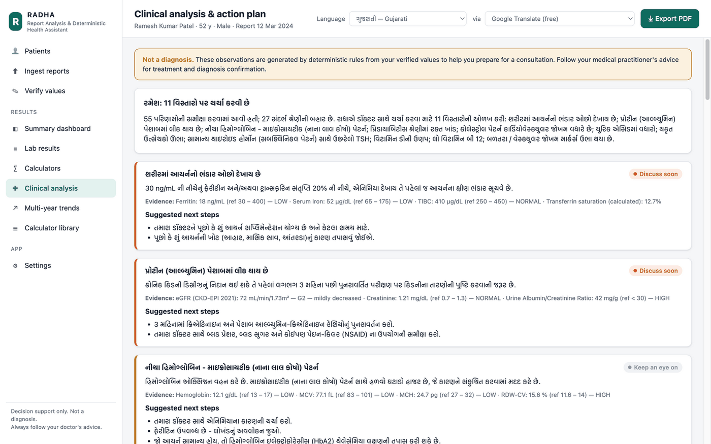

### 3.10 Patients

Each person gets one profile.
- **Profile details:** identity and contact, lab IDs, height, weight, BMI, blood pressure, smoking, alcohol, conditions, medicines, allergies, family history and notes.
- **Reports:** all of that person's reports, with **Open, Edit, Move to another patient, Delete**.
- **Data tools:** **Results as CSV** (opens in Excel), **Merge** duplicate profiles, and **Backup all data** / **Restore backup** for everything.

The profile also fills gaps in reports (age from date of birth, height and weight for BMI and eGFR) and pre-fills calculator inputs: blood pressure, BP medicine and smoking for ASCVD.

| Profile | Reports & data tools |
|---|---|
| 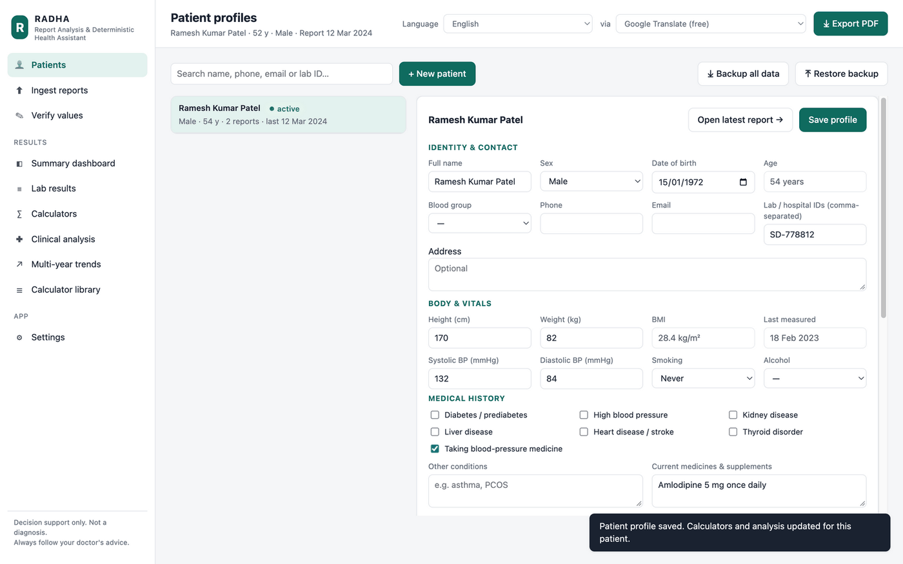 | 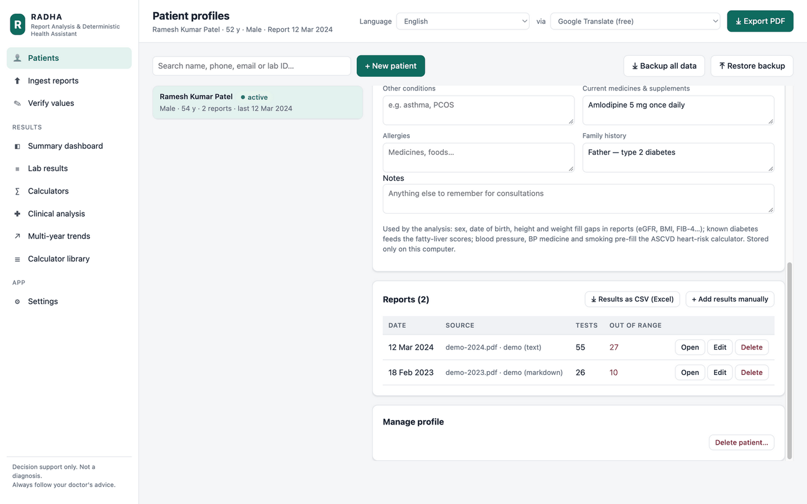 |

---

## 4. How a report is generated

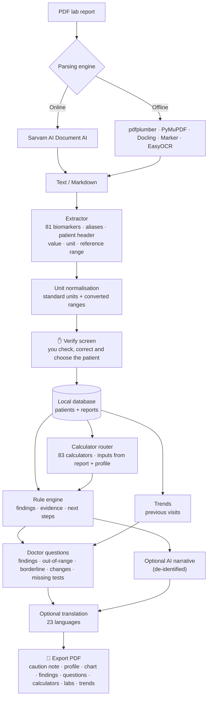

**Step by step**

1. **Parse.** The PDF becomes text, either online or offline.
2. **Extract.** Each line is matched against 81 biomarkers using an alias dictionary that handles spellings such as "Haemoglobin", "SGPT (ALT)" and "25-OH Vitamin D". Values, units and reference ranges are read; labelled decision limits such as "Deficiency < 20" are skipped in favour of the normal range. Patient name, age, sex, date of birth, height, weight, ID and the report date (never the date of birth) are read from the header.
3. **Normalise.** Every value and its reference range is converted to one standard unit, so reports from different labs are comparable.
4. **Verify.** You confirm the values. This is the only point where the data enters the database.
5. **Calculate.** The router runs every calculator whose inputs are present, using report values plus the patient profile.
6. **Analyse.** Fixed rules produce findings with evidence and severity. No AI is involved in this step.
7. **Ask.** The question generator writes the doctor questions, including changes since the previous visit.
8. **Optional.** An AI narrative and a translation are added if you choose.
9. **Export.** A printable A4 PDF is produced, with the caution note at the top and the bottom.

---

## 5. The exported PDF report

Click **Export PDF** (top right). The PDF contains:
- the caution note;
- the patient profile and result chart;
- the clinical analysis with evidence;
- the questions for your doctor;
- the AI narrative, if generated;
- the calculator results;
- all lab results by panel;
- the multi-year comparison.

If a language other than English is selected, the PDF is exported in that language.

| Page 1 | Page 2 | Gujarati |
|---|---|---|
| 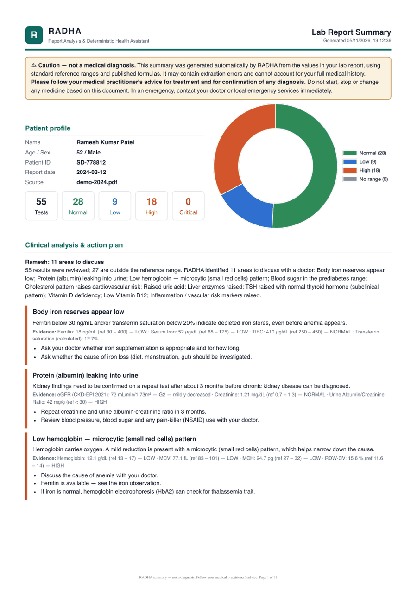 | 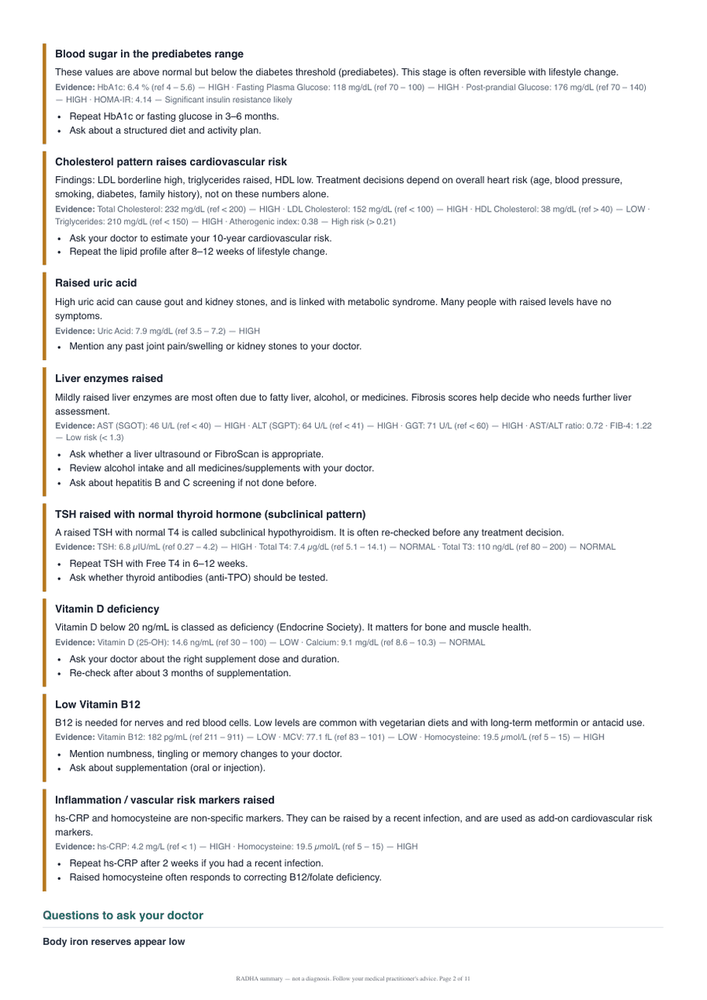 | 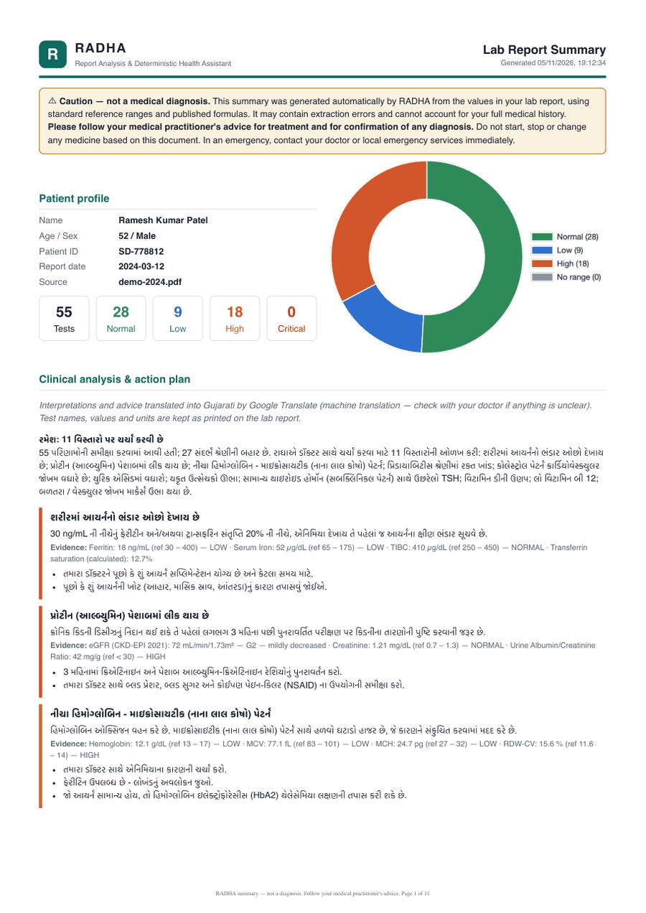 |

Sample files: [English](sample/RADHA-sample-summary-english.pdf) · [Gujarati](sample/RADHA-sample-summary-gujarati.pdf)

---

## 6. Settings: AI and translation services

- **AI providers:** choose which one writes the narrative. You can save or remove keys, **Load models** to list what a provider offers, and **Test** the connection.
- **Translation:** choose the default translator and enter keys, URLs or an email where a service needs them, with a **Test** button for each.
- **Local parsing:** set the Python executable and check which engines are installed.

| AI providers | Translation |
|---|---|
| 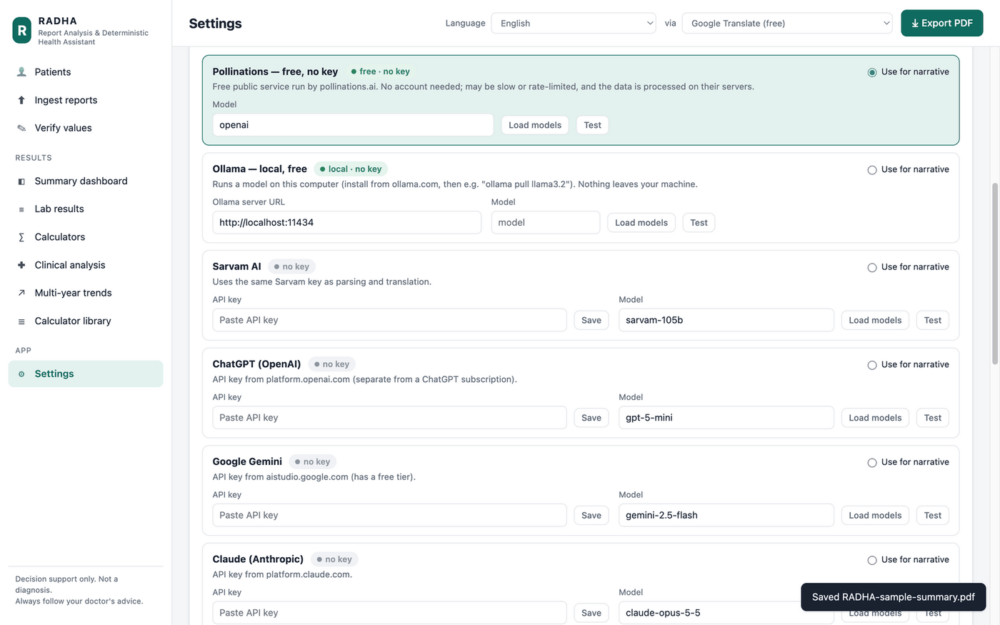 | 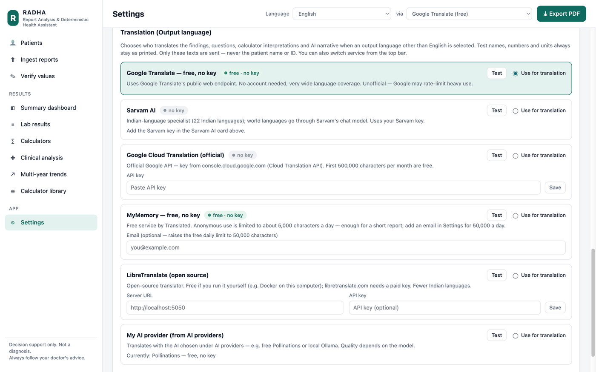 |

---

## 7. Privacy and safety

- **Local storage:** patients, reports and settings are stored only on your computer, in `~/Library/Application Support/RADHA/radha-db.json`. **Backup all data** makes a copy.
- **Encrypted keys:** API keys are encrypted with the macOS keychain.
- **What leaves your computer:**
  - Online parsing sends the PDF to Sarvam AI.
  - Translation and the AI narrative send only the results text, never the name or ID.
  - Ollama keeps everything on your computer.
- **Not a diagnosis:** RADHA is decision support for understanding results and preparing for a consultation. It does not diagnose, and machine translation can contain mistakes.

---

## 8. Troubleshooting

| Problem | What to do |
|---|---|
| "RADHA can't be opened" on first launch | Right-click RADHA → **Open** → **Open** |
| A value or unit was read wrongly | Correct it on the **Verify** screen; open a saved report with **Edit** from the **Patients** tab |
| A report shows the date of birth as its date | **Patients** → that report → **Fix date** |
| "Local engines unavailable" | Install engines with `pip install -r python/requirements.txt` and set the Python path in **Settings** |
| Translation is slow or fails | The free service may be busy — wait a minute or pick another service next to **Language** |
| A calculator doesn't run | Look in **Needs your input** or **Not available** to see what is missing (often height/weight or blood pressure — add them to the patient profile) |
| Duplicate patients | **Patients** → open one → **Merge into this patient** |
