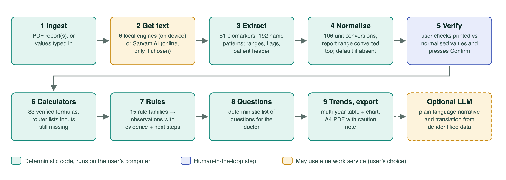
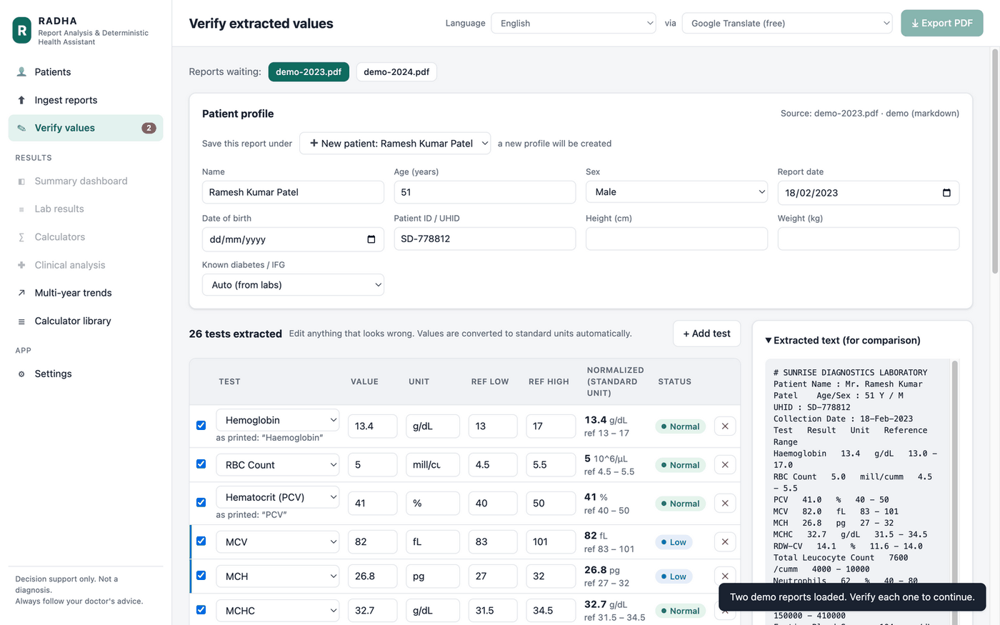
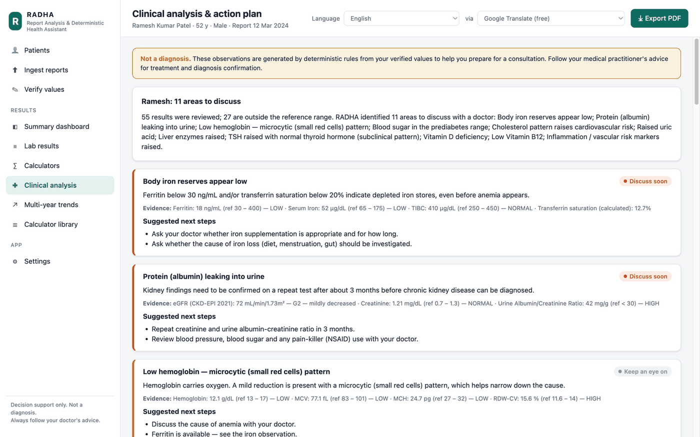
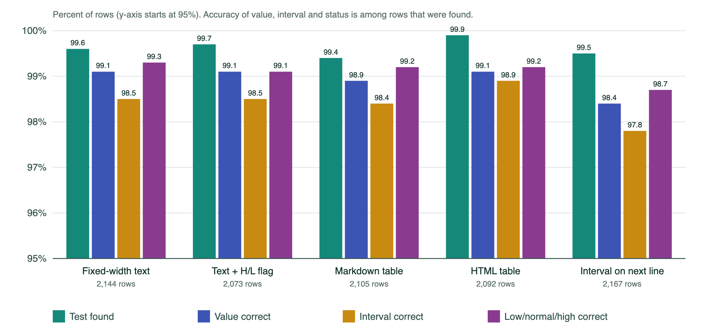

# RADHA: A Local-First, Rule-Based Desktop Application That Turns Laboratory Report PDFs Into Verifiable Patient Summaries

*Design and Evaluation on Synthetic Reports*

Tejas Sheth1 \[M.B.B.S., M.B.A.(H.A.), P.G.C.I.H., P.G.D.A.D.C\]

1 \[Bongaigaon, India\]

**Corresponding author:** Tejas Sheth, drtejassheth@gmail.com

**Running title:** Rule-based, local-first lab report summaries

**Word count:** abstract 374; main text about 4,650 (excluding tables, figure legends and references)

## Abstract

**Background:** Patients in India often receive their blood test results as a PDF, with dozens of values, mixed units and laboratory-specific reference intervals, and no explanation. Large language models (LLMs) can summarise such reports, but they can invent numbers, their output varies between runs, and the usual cloud services require uploading identifiable health data.

**Objective:** To describe RADHA (Report Analysis & Deterministic Health Assistant), a desktop application that extracts, normalises and interprets routine laboratory results with deterministic code on the user’s own computer, and to measure how reliably its text-to-structure layer copes with the formatting variation of real-world reports.

**Methods:** RADHA is an Electron application for macOS and Windows. Report text comes from one of six local parsing engines or, if the user chooses, an online document service. A pattern-based extractor maps test names to 81 canonical biomarkers (192 name patterns), converts units (106 conversion rules) and classifies each value against the report’s own reference interval. The user confirms every value before analysis. Confirmed values feed 83 calculators implemented from their source publications, 15 rule families that produce evidence-linked observations, and a deterministic generator of questions for the doctor. LLMs are optional and receive only de-identified data. We generated 300 synthetic reports (10,581 test rows) in five layouts, with alternative test names, units and missing reference intervals, and compared the extractor’s output with the known ground truth.

**Results:** The extractor found 99.6% of test rows and assigned none to the wrong biomarker. Among found rows, the normalised value was correct in 98.9%, the reference interval in 98.4% and the low/normal/high status in 99.1%; 98.7% of all rows came through correct end to end. Every error traced to one of three faults: a misspelt name pattern, a magnitude rule for small absolute leukocyte counts printed per cubic millimetre, and an unrecognised header label. For a synthetic two-year demonstration case, RADHA ran 45 of 83 calculators and produced 11 observations and 62 questions for the doctor.

**Conclusions:** A rule-based pipeline with a mandatory verification step can turn varied lab report text into structured, traceable summaries without relying on an LLM for any number. Synthetic testing exposed concrete faults that the unit tests had missed. Evaluation on real, de-identified reports and with patients is the next step.

**Keywords:** laboratory test results; information extraction; clinical decision support; medical calculators; patient health records; health literacy; privacy; large language models; India

## Introduction

Blood tests are among the most frequently ordered investigations in medicine. In much of India they are done in private laboratories that give the result directly to the patient, usually as a PDF sent by email or a messaging app, and often hours or days before the patient sees a doctor. The report lists twenty to sixty values, each with a unit and a reference interval chosen by the laboratory, and an H or L beside the ones that fall outside it. What it does not say is which of those flags matter.

Patients find these reports hard to read. An out-of-range flag looks the same whether the deviation is trivial or serious, and without help people struggle to tell the two apart \[1\]. When results are released straight to patients, most say they prefer to see them at once, even before a clinician has reviewed them, although some report more worry as a result \[2\]. Making sense of a report also depends on health literacy, which is unevenly distributed \[3\]. And because laboratories print the same test under different names and in different units (glucose in mg/dL or mmol/L, platelets per microlitre or in lakhs per cubic millimetre), comparing this year’s report with last year’s from another laboratory is harder than it should be.

A routine panel also contains information that nobody works out. The estimated glomerular filtration rate (eGFR) from creatinine \[4\], the FIB-4 fibrosis index from AST, ALT, platelets and age \[5\], HOMA-IR from fasting glucose and insulin \[6\] and an estimated LDL cholesterol \[7\] can all be calculated from values already on the page. Some laboratories print one or two of them. Calculating the rest by hand, with the right units and the right version of each equation, is beyond most patients and is rarely done in a busy outpatient clinic.

Large language models (LLMs) look like the obvious tool for this job. They perform well on medical question-answering benchmarks \[8\] and are being tried for many clinical tasks, including communication with patients \[9\]. For reading lab reports they have three problems. They can produce fluent text that is wrong, including numbers that were never in the source \[10\]. The same input can give different answers on different runs, which makes an output hard to audit. And the convenient way to use them is to upload the report to a cloud service, which sends identifiable health data to a third party; under India’s Digital Personal Data Protection Act, 2023 \[11\] that is a decision that deserves more care than it usually gets.

RADHA (Report Analysis & Deterministic Health Assistant) takes a different approach. It is a free desktop application for macOS and Windows in which every number shown, from a converted unit to a risk score, is produced by code that can be read and tested. The patient, or whoever is helping them, confirms every extracted value before any analysis runs. Processing happens on the user’s computer unless they choose an online service. An LLM is used, if at all, only to rephrase findings that the rules have already produced. The tool is meant to help a patient prepare for a consultation, in the sense of decision support discussed by Sutton et al \[12\], and it does not diagnose.

This paper makes three contributions. We describe the design and implementation of RADHA and the reasoning behind it. We report a reproducible stress test of its extraction and normalisation layer on 300 synthetic reports, together with an analysis of every error it made. And we report what the full pipeline produces for a two-year synthetic demonstration case, including how many calculators a routine report can actually feed.

## Methods

### Design principles

Four principles shaped the design.

**Numbers come from code.** Extraction, unit conversion, classification, calculators and findings are deterministic functions. The same input always gives the same output, and each step can be unit-tested.

**The user confirms the data.** Automated extraction will sometimes be wrong, so nothing is analysed until the user has compared the extracted values with the original text and pressed Confirm.

**Local by default.** Reports, results and profiles stay on the user’s computer. Every step that can use the network (one parsing engine, the narrative and translation) is optional and is labelled as such in the interface.

**Prepare, don’t diagnose.** Output is phrased as observations and questions to take to a doctor. Every screen and every export carries a note that it is not a diagnosis.

### Implementation

RADHA is an Electron application (Electron 45) written in JavaScript. The extraction, normalisation, calculator, rule and question modules are plain ES modules shared by the user interface and the test suite. The local parsing engines run in a private Python 3.12 environment that the application creates in its own data folder with the uv package manager, so the user does not have to install Python. Reports, profiles and settings are kept in a JSON file in the operating system’s per-user application data folder. API keys for optional services are encrypted with the operating system’s credential store through Electron’s safeStorage interface. Installers are built for macOS on Apple silicon and for Windows 10 and 11 (x64). Figure 1 shows the pipeline; the version described here is 0.2.3.

**Figure 1.** The RADHA pipeline. Green steps are deterministic and run on the user’s computer. The verification step (blue) is mandatory. Amber steps use a network service only if the user chooses one.

### Getting text from the PDF

The user drops one or more PDFs onto the ingest screen, or types values in by hand. Six engines run locally. pdfplumber and PyMuPDF read the text layer embedded in most digitally generated PDFs. Apple Vision OCR (macOS only) and EasyOCR recognise text on scanned pages. Docling \[13\] and Marker reconstruct the page layout and return Markdown, tables included. An Auto mode reads the text layer first and sends to OCR only the pages that have no usable text, which handles PDFs that mix digital and scanned pages. The seventh engine, Sarvam AI’s online document service, needs an API key and uploads the PDF; the interface says so before it is used.

The local engines install from inside the application with one click. An essential set (pdfplumber, PyMuPDF and Apple Vision OCR) takes about 0.2 GB, and the full set about 2.2 GB. Each engine shows its download size and memory use before it is installed, and each has settings that can be tried on a sample report.

### Extraction

The extractor receives plain text or Markdown and first flattens Markdown and HTML tables into lines. It then compares every line with a dictionary of 81 canonical biomarkers in ten panels (Table 1). Each biomarker has one or more name patterns, 192 in all, written as regular expressions so that “Haemoglobin”, “Hb” and “HGB” resolve to the same entry. A name may be preceded by a row number or a specimen word such as “Serum” or “Plasma”. When several patterns match a line, the longest match wins, which stops “Absolute Neutrophil Count” from being read as “Neutrophils”.

The text after the name is parsed for a numeric value with an optional qualifier (< or >), a high or low flag, a unit and a reference interval. Reference cells are less simple than they look. Lipid and vitamin D reports often print several labelled bands in one cell, for example “Desirable < 200, Borderline High 200–239, High ≥ 240”. RADHA takes the first band that is unlabelled or labelled normal, desirable, optimal or sufficient, and skips bands labelled deficiency, risk, borderline or high. If the line has no interval, the next three lines are searched for one introduced by a phrase such as “Bio. Ref. Range”. A differential count printed in absolute units is filed under the absolute count rather than the percentage. Lines that look like a result (a name, a value and a range) but match no known biomarker are kept as “Other” rows rather than discarded. The report header is searched for the patient’s name, age, sex, report date and laboratory identifier, taking care never to use a date of birth as the report date.

### Normalisation and classification

Each biomarker has one canonical unit, and every later module works only in those units. The dictionary holds 106 unit conversions: mmol/L to mg/dL for glucose (×18.016), cholesterol (×38.67) and triglycerides (×88.57), µmol/L to mg/dL for creatinine and bilirubin, mmol/mol to percent for HbA1c using the IFCC–NGSP master equation, and so on. Unit strings are normalised before lookup so that “gm/dl”, “g%” and “g/dL” are treated alike. Cell counts are handled by magnitude rather than by the unit text, because laboratories print the same count as 8,900 /cumm, 8.9 ×10³/µL or 2.45 lakhs/cumm. The laboratory’s own reference interval is converted with the same factor as the value. When the report gives no interval, RADHA applies an adult default, which is sex-specific for 10 biomarkers. Each value is then classified as low, normal or high against its interval. Thirteen biomarkers also carry critical limits (for example haemoglobin below 7 g/dL, or platelets below 50 ×10³/µL) that raise an urgent observation.

### Verification

The verification screen (Figure 2) shows an editable table with one row per extracted test: the name as printed, the value, unit and interval as read, the normalised value and its classification. The extracted text sits alongside for comparison. The user can correct any cell, reassign a row to a different biomarker, untick rows to leave them out, add tests the extractor missed and edit the patient details. Nothing downstream runs until the user presses Confirm. Confirmed reports are saved and linked to a patient profile, matched by laboratory ID or name, and the profile supplies values that reports rarely contain, such as height, weight, blood pressure and smoking status.

**Figure 2.** The verification screen for the synthetic demonstration patient. Each row shows the value and unit as printed, the normalised value and its status; the extracted text is on the right. Analysis starts only after the user presses Confirm.

### Calculators

RADHA includes 83 calculators implemented from their primary publications and checked against published worked examples (Table 1). Among them are five eGFR equations (CKD-EPI 2009 and 2021, cystatin C, creatinine with cystatin C \[4\], and MDRD), albuminuria staging following KDIGO \[14\], FIB-4 \[5\], APRI and the NAFLD fibrosis score, the MELD family \[15\], HOMA-IR and HOMA-β \[6\], the pooled cohort equations for 10-year cardiovascular risk \[16\], the Sampson and Friedewald estimates of LDL cholesterol \[7\], and indices used to screen for thalassaemia trait. A router checks each calculator’s inputs against the confirmed results and the patient profile. Calculators whose inputs are all present run at once; the others are listed with the specific inputs they lack. 17 calculators also need values that never appear on a lab report, such as blood pressure, smoking status or ascites, which the user can type in.

Alongside the verified set, RADHA carries a reference library of 2,015 calculators assembled from a large collection of published calculator descriptions, with source-website attribution removed. Each entry keeps its inputs, formula text, interpretation and references, and every entry can be filled in. How the result is produced depends on the entry. The 122 entries that correspond to a verified implementation use it. For points-based scores, a parser reads the published points table and builds an executable scoring rule. The parser is strict on purpose: it accepts a table only if every option of every input can be matched unambiguously to a points value, and it rejects any input whose options all carry the same score, on the reasoning that an answer that never changes the total means the table has been misread. That second check caught an error in the source table for the Wells criteria for deep-vein thrombosis, where calf swelling was listed as scoring a point when absent; we corrected it against the original publication \[17\]. 123 calculators passed these checks. The remaining entries can be calculated by an LLM of the user’s choosing. Only the formula text and the entered values are sent, and the interface labels the result as not verified by RADHA.

### Observations and questions for the doctor

Fifteen rule families turn confirmed values and calculator results into observations. They cover critical values, the haemoglobin pattern (microcytic, normocytic or macrocytic, by mean corpuscular volume), iron stores, white cells, platelets, glycaemic status, lipids, kidney function with albuminuria, uric acid, electrolytes, liver enzymes, thyroid function, vitamin D, vitamin B12 with homocysteine, and inflammatory markers. Each observation has a severity (urgent, attention, watch or information), a short plain-language explanation, the evidence values with their reference intervals, and suggested next steps (Figure 3). The rules use common clinical thresholds. The iron rule, for instance, fires when ferritin is below 30 ng/mL or transferrin saturation below 20%, and it calculates the saturation from serum iron and total iron-binding capacity when the laboratory has not printed it.

A separate generator writes the list of questions to ask the doctor. It produces questions for each observation, for every other result that is out of range or close to a limit, for calculator results in a flagged band, for changes since the patient’s previous report, and for common tests that the report does not include, followed by a few general questions. A result that an observation already explains does not get a second question of its own.

**Figure 3.** Rule-based observations for the 2024 synthetic report. Each observation lists its evidence (value, reference interval and status) and suggested next steps; the banner states that the output is not a diagnosis.

### Optional narrative and translation

The user can ask an LLM to write a short plain-language summary. The request contains the patient’s age and sex, the confirmed results with their intervals and status, the calculator results that ran, and the rule-based findings. It does not contain the name, laboratory ID or report date. The system prompt tells the model to use only these facts, not to add diagnoses, drug names or doses, to stay under 300 words, and to end by reminding the reader that the summary is not a diagnosis. Seven providers can be selected: Pollinations (a free public service, the default), Ollama (fully local), Sarvam AI, OpenAI, Google Gemini, Anthropic Claude and any OpenAI-compatible endpoint. The narrative appears below the rule-based findings, which remain the reference.

Findings, questions, calculator interpretations and the narrative can be translated into 23 languages besides English, 13 of them Indian languages, through a translation service the user chooses. Test names, numbers and units are never translated, so a translated summary still lines up with the printed report.

### Trends and export

Confirmed reports for the same patient form a time series. The trends view shows a year-by-year table with the percentage change and direction for each test, and a chart with the reference limits drawn in. The export is an A4 PDF in the chosen language containing the caution note, the patient profile, findings, questions, calculator results, laboratory values and trends.

### Evaluation

**Software tests.** The code base contains 25 automated tests. They cover extraction of patient details and results from a plain-text report and from Markdown tables, unit and count normalisation, date parsing, the calculators (including the pooled cohort equations against the guideline’s worked examples, the MELD family and the kidney equations), the rule engine, the engine installer, and the scoring of library calculators. All 25 pass on version 0.2.3.

**Synthetic stress test.** Unit tests check the cases a developer has thought of. To probe the variation the extractor meets in practice, we wrote a generator of synthetic reports and scored RADHA’s output against the generator’s ground truth. Each report belongs to a fictitious patient with a random sex, age (18–87 years), laboratory ID and report date, and has a header in one of three styles. It contains 25 to 45 tests drawn at random from a pool of 77 biomarkers: every biomarker with a reference interval, except four that are rarely reported and the “Other” panel.

For each test the generator chose a target status (low with probability 0.2 where a lower limit exists, high with probability 0.2, otherwise normal) and drew a value at least 10% of the interval width away from either limit, so that rounding could not change the status. Test names were varied: for 28 commonly renamed tests, 70% of rows used an alternative name from a list of names used by Indian laboratories, written independently of RADHA’s patterns (for example “SGPT”, “Total Leucocyte Count”, “PPBS” and “Glycated Haemoglobin”). Units were varied: about 35% of rows with a realistic alternative unit were printed in it, absolute counts were printed per cubic millimetre half the time, and platelets were printed in one of three conventions. The reference interval was left out of 10% of rows. Reports were rendered in five layouts that imitate what the parsing engines produce: fixed-width text, fixed-width text with an H/L flag column, a Markdown table, an HTML table, and a layout with the interval on the line below the result. We generated 60 reports per layout, 300 in all, from a fixed random seed.

The outcomes were the proportion of test rows found under the correct biomarker; among found rows, the proportions whose normalised value, reference interval and low/normal/high status matched the ground truth (values within 2% or 0.011 units); the proportion of all rows that ended with the correct status; the number of rows assigned to a biomarker that was not on the report; and the accuracy of five header fields. This test measures the text-to-structure layer only. It does not test the PDF and OCR engines that sit upstream of it.

**Demonstration case.** RADHA ships with two synthetic reports for a fictitious man, aged 51 at the first: one from 2023 in Markdown-table form and one from 2024 in plain text. We ran both through the whole pipeline (extraction, calculators, rules and questions, with the 2023 report as the previous report for 2024) and recorded the output.

**Ethics.** No human participants or patient records were involved. All reports used in this study were synthetic.

## Results

### Knowledge base

Table 1 summarises the biomarker dictionary and the verified calculators. The complete blood count accounts for 25 of the 81 biomarkers, which reflects how many separate values a blood count report prints. Liver and blood calculators (16 each) and kidney calculators (13) make up more than half of the 83. Of the 2,015 library calculators, 920 take only multiple-choice answers and are therefore candidates for points-table scoring; 123 of them passed the parser’s checks, and 100 of those also have a parsed table of risk bands.

**Table 1.** Biomarker dictionary by panel and verified calculators by category.

| **Panel** | **Biomarkers** | **Calculator category** | **Calculators** |
| --- | --- | --- | --- |
| Complete Blood Count | 25 | Liver | 16 |
| Diabetes / Glycemic | 5 | Blood | 16 |
| Lipid Profile | 8 | Kidney | 13 |
| Kidney Function | 8 | Electrolytes | 11 |
| Electrolytes & Minerals | 7 | Lipids | 9 |
| Liver Function | 11 | Diabetes | 8 |
| Thyroid | 5 | Body | 5 |
| Vitamins & Iron | 7 | Inflammation | 3 |
| Inflammation & Cardiac | 4 | Iron | 1 |
| Other | 1 | Thyroid | 1 |
| **Total** | **81** | **Total** | **83** |

The dictionary also holds 192 name patterns, 106 unit conversions, critical limits for 13 biomarkers and sex-specific default intervals for 10.

### Synthetic stress test

Across 300 reports and 10,581 test rows, the extractor found 10,542 rows (99.6%) under the correct biomarker and did not assign a single row to a biomarker that was absent from the report (Table 2, Figure 4). Among found rows, the normalised value was correct in 98.9%, the reference interval in 98.4% and the status in 99.1%. Over all rows, including those not found, 98.7% ended with the correct status. The five layouts performed much alike; the layout with the interval on the next line was slightly weaker on values and intervals. Where the interval had been left out, the correct default was applied in 99.7% of 1,064 rows. Rows printed in a non-default unit were the weakest group, at 95.5% correct.

Age, sex, report date and laboratory ID were read correctly from all 300 headers. The patient’s name was read from 200 of 300 (66.7%).

**Table 2.** Extraction and normalisation accuracy on 300 synthetic reports (60 per layout).

| **Layout** | **Rows** | **Found, %** | **Value correct, %** | **Interval correct, %** | **Status correct, %** | **Non-default unit: rows (% correct)** | **Interval omitted: rows (% default applied)** | **Wrong-biomarker matches** |
| --- | --- | --- | --- | --- | --- | --- | --- | --- |
| Fixed-width text | 2,144 | 99.6 | 99.1 | 98.5 | 99.3 | 524 (96.4) | 215 (99.5) | 0 |
| Text with H/L flag column | 2,073 | 99.7 | 99.1 | 98.5 | 99.1 | 497 (96.2) | 205 (100.0) | 0 |
| Markdown table | 2,105 | 99.4 | 98.9 | 98.4 | 99.2 | 497 (95.6) | 194 (99.5) | 0 |
| HTML table | 2,092 | 99.9 | 99.1 | 98.9 | 99.2 | 486 (96.3) | 238 (100.0) | 0 |
| Interval on next line | 2,167 | 99.5 | 98.4 | 97.8 | 98.7 | 525 (93.3) | 212 (99.5) | 0 |
| **All layouts** | 10,581 | 99.6 | 98.9 | 98.4 | 99.1 | 2,529 (95.5) | 1,064 (99.7) | 0 |

Value, interval and status accuracy are among rows that were found. Values were counted as correct within 2% or 0.011 units.

**Figure 4.** Accuracy by report layout in the synthetic stress test. The y-axis starts at 95%.

### Error analysis

Every error in the stress test came from one of three faults (Table 3).

The first was a typing error in a name pattern. The HbA1c pattern had been written so that it matched “glycosylated” but expected “glycatated” instead of “glycated”. All 39 rows that used the name “Glycated Haemoglobin” were missed. Of these, 24 still reached the verification table as unrecognised “Other” rows carrying the correct value; the other 15 had no interval on the same line and were dropped.

The second was the magnitude rule for cell counts. The normaliser decides whether a count needs dividing by 1,000 from its size, treating anything above 200 as a per-cubic-millimetre count. Absolute basophil and eosinophil counts, and some monocyte counts, are genuinely below 200 /mm³, so they were left unscaled and came out 1,000 times too high. This caused 113 value errors. It also caused 67 interval errors in rows whose value was correct: for a monocyte interval printed as 200–1,000 /mm³, the upper limit was rescaled to 1 but the lower limit stayed at 200. This one fault accounts for almost all the errors in the non-default-unit group.

The third was in the header parser, which did not recognise “Patient :” as a label for the name. One of the three header styles used it, so the name was missing from a third of the reports.

There were no other errors. All three faults are deterministic: each fails the same way every time, and each could be traced to a specific line of code. None was caught by the existing automated tests, all of which passed.

**Table 3.** The three faults found by the synthetic stress test.

| **Fault** | **Rows or reports affected** | **Effect** | **Visible at verification?** | **Fix** |
| --- | --- | --- | --- | --- |
| HbA1c name pattern misspelt; “Glycated Haemoglobin” not recognised | 39 rows (0.37%) | 24 kept as unrecognised “Other” rows with correct value; 15 dropped | Partly: an “Other” row with the printed name, or a missing test | Correct the pattern |
| Small absolute leukocyte counts per mm³ (basophils, eosinophils, monocytes) not rescaled | 113 value errors; 67 interval errors | Value or lower limit 1,000 times too high; status wrong | Yes: normalised value shown beside the printed value | Use the printed unit, not the magnitude, when a unit is present |
| Header label “Patient :” not recognised | 100 of 300 reports | Name field empty; age, sex, date and ID correct | Yes: empty name field | Add the label to the header parser |

### Demonstration case

Table 4 shows the output for the demonstration case. The 2023 Markdown report yielded 26 tests and the 2024 plain-text report 55, all mapped to known biomarkers. For the 2024 report, 45 of the 83 calculators ran, 10 more needed only values that never appear on a lab report, and 28 lacked at least one laboratory or demographic input. The rules produced 11 observations, two rated “attention” (low iron stores and albumin in the urine) and nine rated “watch”, and the generator produced 62 questions for the doctor.

The inputs that most often kept a calculator from running were weight (11 calculators), height (6), INR (6), body mass index (5) and bicarbonate (4). Three of these five are not laboratory values at all. Once the user enters height and weight in the patient profile, they are reused for every later report.

**Table 4.** Pipeline output for the two synthetic demonstration reports.

|  | **2023 report (Markdown table)** | **2024 report (plain text)** |
| --- | --- | --- |
| Tests extracted | 26 | 55 |
| Outside reference interval (low / high) | 10 (3 / 7) | 27 (9 / 18) |
| Calculators run (of 83) | 27 | 45 |
| Calculators needing only typed-in values | 1 | 10 |
| Calculators lacking a report or profile input | 55 | 28 |
| Calculator results in a flagged band | 14 | 27 |
| Rule-based observations | 4 | 11 |
| Questions for the doctor | 36 | 62 |

The 2024 analysis used the 2023 report as the previous report, so its questions include changes over the year.

## Discussion

### Principal findings

RADHA shows that the routine part of reading a lab report (finding the values, putting them in standard units, comparing them with the right interval and running the usual derived scores) can be done by ordinary deterministic code on a personal computer. On synthetic reports in the layouts its parsing engines produce, the extractor found 99.6% of tests, assigned none to the wrong biomarker, and brought 98.7% of all rows through with the correct status.

The errors are more interesting than the headline figures. They all came from three faults, each a specific mistake that repeats exactly. None was caught by the automated tests, which passed throughout; the synthetic test found all three within minutes of being written, and each needs only a small change to fix. This is the practical argument for deterministic extraction. Its errors are systematic, so they can be found, explained and removed, and a fix stays fixed. An LLM-based extractor might well cope better with unusual test names, but its mistakes would not repeat in the same way, and a test it passes today says less about its output tomorrow.

The verification screen is the second line of defence. In this test it would have put most of the errors in front of the user: an unrecognised HbA1c appears as an “Other” row under its printed name, a basophil count 1,000 times too high sits beside the value as printed, and an empty name field is hard to miss. We have not measured how often users actually notice such errors, and some will certainly press Confirm without looking closely. The screen reduces the risk; it does not remove it.

### Where an LLM fits

RADHA uses an LLM for what LLMs do well, rephrasing and translation, and keeps it away from numbers. The narrative is written from findings the rules have already produced, so the model is asked to explain rather than to discover. That does not make the narrative safe by construction. A model can still overstate a finding or soften a warning, and we have not yet evaluated the narratives. Keeping the rule-based findings on screen above the narrative at least gives the reader a fixed reference to check it against. The AI-assisted tier of the calculator library is the one place where an LLM produces a number, and it is labelled as unverified for that reason.

### What a lab report can and cannot support

The demonstration case shows both the reach and the limits of a routine report. A 55-test panel was enough to run 45 calculators, yet the inputs missing most often were height and weight rather than laboratory values. A report that recorded them would unlock a further group of scores; in RADHA the user enters them once in the patient profile. The library parser takes the same conservative line as the rest of the system and would rather leave a calculator unscored than score it from a half-read table, which is why only 123 of 920 multiple-choice calculators qualified. The Wells example is a reminder that published reference material has errors of its own. A check that every answer can change the score is cheap enough to apply everywhere.

### Privacy

With a local parsing engine, nothing leaves the computer unless the user asks for a narrative or a translation, and those requests carry no name, ID or date. They do carry age, sex and a full set of results, which together could in principle help to re-identify someone, particularly in a small population, so “de-identified” should be read as a reduction in risk rather than anonymity. A user who wants no network traffic at all can choose a local engine, Ollama for the narrative and English output. The Sarvam engine uploads the whole PDF, and the interface says so.

### Limitations

This study has clear limitations. First, every report in the evaluation was synthetic, and the generator was written by the developer who wrote the extractor. The alternative names were written without reference to the patterns, but the two still share one person’s idea of what a lab report looks like, so the accuracy figures should be read as an upper bound for real reports. Second, the stress test started from text. It did not evaluate the PDF and OCR engines, where errors on scanned or photographed reports are likely to be larger. Third, the content of the rules and the generated questions has not been reviewed by an independent clinical panel, and the default reference intervals are for adults; they do not cover children or pregnancy. Fourth, we did not study users. We do not know whether patients understand the output, whether it changes the conversation with their doctor, or whether it causes needless worry. Fifth, the quality of the LLM narratives and of the translations was not assessed. Finally, the tool was built and evaluated by a single developer around the layouts of Indian private laboratories, and reports from elsewhere may differ.

### Future work

The immediate next steps are to fix the three faults and add the synthetic test to the automated suite, so that each new release is checked against it. Beyond that, we plan to assemble a test set of real, de-identified reports from several laboratories, with ethics committee approval, and use it to compare the parsing engines end to end; to have the rules and questions reviewed by clinicians; to map the biomarker dictionary to LOINC codes \[18\] so that results can be exchanged with other systems; and to study patients using RADHA before real consultations.

## Conclusions

RADHA turns the PDF lab report a patient receives into a structured, checked and explained summary, using deterministic code that runs on the patient’s own computer and asking the patient to confirm every value. On synthetic reports its extraction layer was accurate, and its errors were few, systematic and easy to fix. Rule-based processing will not read every report a laboratory can produce, but when it fails it fails in ways that can be seen and corrected, which for health data matters more than fluency. Whether the summaries actually help patients is a question for a study with real reports and real users.

## Declarations

**Ethics approval:** Not applicable. The study used only synthetic data and involved no human participants or patient records.

**Data and code availability:** The synthetic report generator, the evaluation scripts and their full output are available from the author \[or: at repository/DOI\]. The RADHA application is free to download; its source code is held in a private repository and is available from the author on reasonable request.

**Competing interests:** The author developed RADHA and distributes it free of charge.

**Funding:** None

**Use of AI-assisted tools:** Claude Code.

## Abbreviations

ALT: alanine aminotransferase; APRI: AST to platelet ratio index; AST: aspartate aminotransferase; CKD-EPI: Chronic Kidney Disease Epidemiology Collaboration; eGFR: estimated glomerular filtration rate; FIB-4: fibrosis-4 index; HbA1c: glycated haemoglobin; HOMA-IR: homeostasis model assessment of insulin resistance; IFCC: International Federation of Clinical Chemistry; INR: international normalised ratio; KDIGO: Kidney Disease: Improving Global Outcomes; LDL: low-density lipoprotein; LLM: large language model; LOINC: Logical Observation Identifiers Names and Codes; MELD: Model for End-Stage Liver Disease; NGSP: National Glycohemoglobin Standardization Program; OCR: optical character recognition.

## References

1. Zikmund-Fisher BJ, Scherer AM, Witteman HO, Solomon JB, Exe NL, Tarini BA, et al. Graphics help patients distinguish between urgent and non-urgent deviations in laboratory test results. J Am Med Inform Assoc. 2017;24(3):520–528.

2. Steitz BD, Turer RW, Lin CT, MacDonald S, Salmi L, Wright A, et al. Perspectives of patients about immediate access to test results through an online patient portal. JAMA Netw Open. 2023;6(3):e233572.

3. Sørensen K, Van den Broucke S, Fullam J, Doyle G, Pelikan J, Slonska Z, et al. Health literacy and public health: a systematic review and integration of definitions and models. BMC Public Health. 2012;12:80.

4. Inker LA, Eneanya ND, Coresh J, Tighiouart H, Wang D, Sang Y, et al. New creatinine- and cystatin C-based equations to estimate GFR without race. N Engl J Med. 2021;385(19):1737–1749.

5. Sterling RK, Lissen E, Clumeck N, Sola R, Correa MC, Montaner J, et al. Development of a simple noninvasive index to predict significant fibrosis in patients with HIV/HCV coinfection. Hepatology. 2006;43(6):1317–1325.

6. Matthews DR, Hosker JP, Rudenski AS, Naylor BA, Treacher DF, Turner RC. Homeostasis model assessment: insulin resistance and β-cell function from fasting plasma glucose and insulin concentrations in man. Diabetologia. 1985;28(7):412–419.

7. Sampson M, Ling C, Sun Q, Harb R, Ashmaig M, Warnick R, et al. A new equation for calculation of low-density lipoprotein cholesterol in patients with normolipidemia and/or hypertriglyceridemia. JAMA Cardiol. 2020;5(5):540–548.

8. Singhal K, Azizi S, Tu T, Mahdavi SS, Wei J, Chung HW, et al. Large language models encode clinical knowledge. Nature. 2023;620(7972):172–180.

9. Thirunavukarasu AJ, Ting DSJ, Elangovan K, Gutierrez L, Tan TF, Ting DSW. Large language models in medicine. Nat Med. 2023;29(8):1930–1940.

10. Ji Z, Lee N, Frieske R, Yu T, Su D, Xu Y, et al. Survey of hallucination in natural language generation. ACM Comput Surv. 2023;55(12):248.

11. The Digital Personal Data Protection Act, 2023 (No. 22 of 2023). New Delhi: Ministry of Law and Justice, Government of India; 2023.

12. Sutton RT, Pincock D, Baumgart DC, Sadowski DC, Fedorak RN, Kroeker KI. An overview of clinical decision support systems: benefits, risks, and strategies for success. NPJ Digit Med. 2020;3:17.

13. Auer C, Lysak M, Nassar A, Dolfi M, Livathinos N, Vagenas P, et al. Docling technical report. arXiv:2408.09869 \[preprint\]. 2024.

14. Kidney Disease: Improving Global Outcomes (KDIGO) CKD Work Group. KDIGO 2012 clinical practice guideline for the evaluation and management of chronic kidney disease. Kidney Int Suppl. 2013;3(1):1–150.

15. Kamath PS, Wiesner RH, Malinchoc M, Kremers W, Therneau TM, Kosberg CL, et al. A model to predict survival in patients with end-stage liver disease. Hepatology. 2001;33(2):464–470.

16. Goff DC Jr, Lloyd-Jones DM, Bennett G, Coady S, D’Agostino RB, Gibbons R, et al. 2013 ACC/AHA guideline on the assessment of cardiovascular risk. Circulation. 2014;129(25 Suppl 2):S49–S73.

17. Wells PS, Anderson DR, Rodger M, Forgie M, Kearon C, Dreyer J, et al. Evaluation of D-dimer in the diagnosis of suspected deep-vein thrombosis. N Engl J Med. 2003;349(13):1227–1235.

18. McDonald CJ, Huff SM, Suico JG, Hill G, Leavelle D, Aller R, et al. LOINC, a universal standard for identifying laboratory observations: a 5-year update. Clin Chem. 2003;49(4):624–633.
